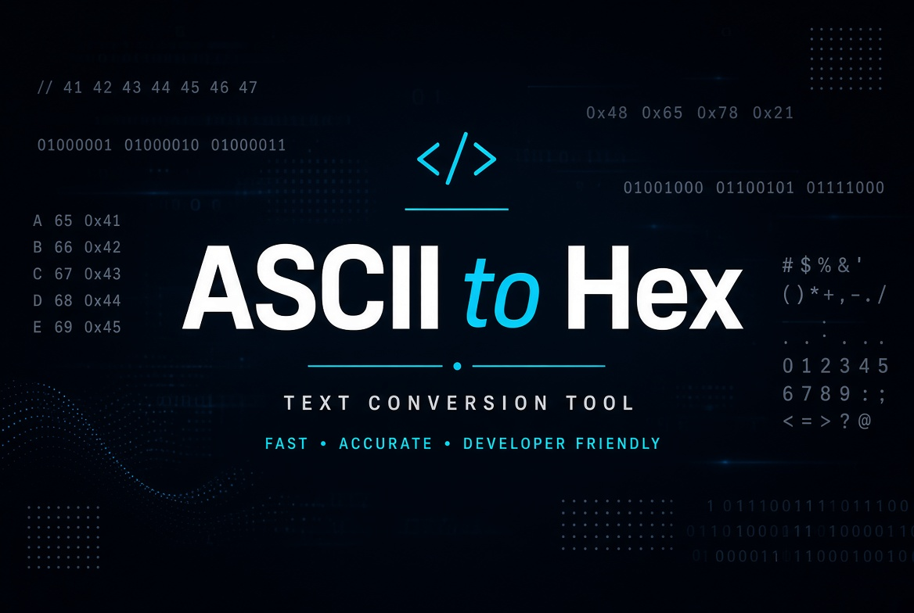

  

<h1 align="center">ASCII to Hex</h1>

  <strong>Free, client-side text conversion tools</strong> 
  Convert ASCII to Hex, Binary, Base64, Decimal, ROT13, URL encoding, and HTML entities — and back.

  
  

---

## Live Demo

**https://pdragonlabs.github.io/asciihex/**

Open the page, edit any field, and hit **Convert** to update every other format instantly.

## Features

| Format | Description |
|--------|-------------|
| **Binary** | Space-separated 8-bit bytes |
| **Hexadecimal** | Space-separated hex bytes |
| **Base64** | Standard Base64 encoding |
| **Decimal** | Space-separated character codes |
| **ROT13** | Caesar cipher shifted by 13 |
| **URL Encoded** | Percent-encoding (spaces as `+`) |
| **HTML Entities** | HTML-safe entity encoding |

- Bidirectional — convert from any field
- One-click **Copy to clipboard**
- Light / dark theme (saved in localStorage)
- Pre-filled sample text
- 100% client-side, no server needed

## Quick Start

1. Visit the [live site](https://pdragonlabs.github.io/asciihex/) or open `index.html` locally.
2. Type or paste text in any box.
3. Click the **Convert from …** button for that field.
4. Copy the results you need.

## Files

- `index.html` / `ascii-to-hex.html` — the single-file converter
- `images/banner.jpg` — header banner

## License

Free to use and modify.

---

  Inspired by <a href="https://www.asciitohex.com/">asciitohex.com</a>

